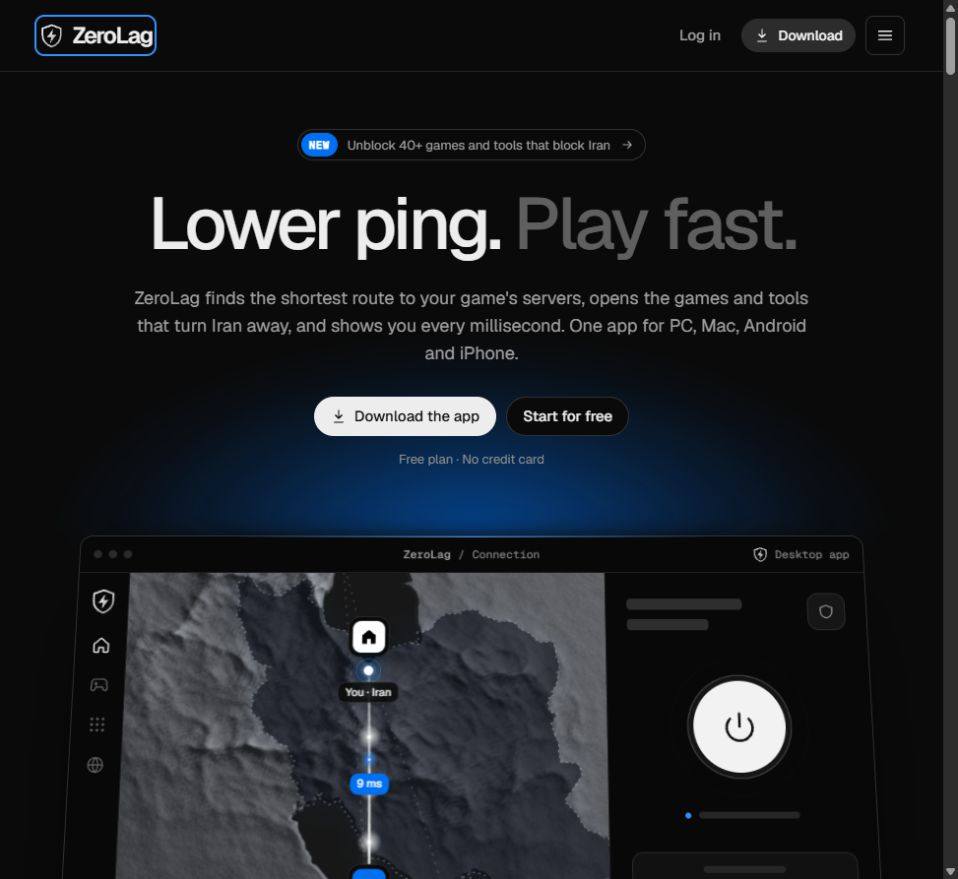

# ZeroLag Landing

**Product Design · Interactive Product Prototypes · Marketing Website**

An interactive front-end prototype of the ZeroLag marketing website, designed and implemented by [Ardeshir Rashidi](https://github.com/Ardeshir-Rashidi). It brings the product's navigation, service discovery, pricing and download journeys into a browsable Next.js experience.

This repository contains the **landing and marketing website**. The ZeroLag dashboard and application are separate projects and will be added independently.

[View live demo](https://ardeshir-rashidi.github.io/zerolag-landing/)



## Tech Stack

<p>
  <a href="https://nextjs.org/" title="Next.js"></a>
  <a href="https://react.dev/" title="React"></a>
  <a href="https://www.typescriptlang.org/" title="TypeScript"></a>
  <a href="https://developer.mozilla.org/en-US/docs/Web/CSS" title="CSS Modules"></a>
</p>

| Layer | Technology |
| --- | --- |
| Framework & routing | Next.js 16.4.6 · App Router · static export |
| Interface | React 19.3.1 · Server and Client Components |
| Language | TypeScript 5.9.3 |
| Styling | CSS Modules · CSS custom properties · responsive layouts |
| Visual interactions | Browser Canvas, SVG and WebGL · custom animations |
| Typography | Geist and Geist Mono via Google Fonts |

**Tools & Workflow**

<p>
  <a href="https://git-scm.com/" title="Git"></a>
  <a href="https://github.com/" title="GitHub"></a>
</p>

## Experience

- Marketing home page with an interactive connection schematic, product stories, feature sections and scroll motion.
- Game and app discovery, searchable locations, and interactive globe views.
- Pricing comparisons, billing controls and FAQs.
- Platform-specific download previews and a contact form with client-side validation.
- Shared navigation, responsive menu and reusable page sections.

## Routes

| Route | Purpose |
| --- | --- |
| `/` | Marketing home page |
| `/games` | Game library |
| `/apps` | Supported app library |
| `/locations` | Location exploration |
| `/pricing` | Plans and comparisons |
| `/about` | Product story |
| `/contact` | Contact form preview |
| `/download` | Device and download previews |

Download links support `?os=win`, `mac`, `and` or `ios`; location links support `?city=<id>`.

## Run locally

Use Node.js 22 LTS and npm.

```bash
npm ci
npm run dev
```

Open [localhost:3000](http://localhost:3000). Check and export the site with:

```bash
npm run typecheck
npm run build
```

The build generates `out/` for static hosting. For a GitHub project URL, set `NEXT_PUBLIC_BASE_PATH=/zerolag-landing` when building. Local development defaults to the domain root.

## Project structure

```text
app/                   App Router pages, layouts and global style layers
components/            Route sections and shared interface components
data/                  Typed product, game, app and location content
lib/site/              Browser interaction runtime and feature modules
lib/map/               Canvas/WebGL map engine
lib/paths.ts           Public asset paths for root or subpath hosting
public/                Images and geographic data
docs/                  Architecture and implementation notes
.github/workflows/     Build verification and GitHub Pages deployment
```

See [architecture notes](docs/ARCHITECTURE.md) for interaction lifecycle and styling details.

## Prototype scope

The connection metrics, network behavior, product screens and commercial flows demonstrate interface behavior. This repository does not implement a VPN/routing backend, account authentication, payment processing, native installers or contact-message delivery. The contact form validates locally and shows a preview response.

Some legacy interaction and map modules use `@ts-nocheck` while they are gradually typed and moved into React. The TypeScript check therefore does not provide full coverage of that runtime. Google Fonts requires an internet connection.

## Credits and usage

Technology icons: [Skill Icons](https://github.com/tandpfun/skill-icons). Third-party game artwork, names and trademarks belong to their respective owners. This repository is presented as a design portfolio prototype; no blanket reuse license is granted for the design, code or third-party artwork.
